  

# 🛡️ Awesome AI Privacy & Watermark Removal

  
  
  
  
  
  
  

> **The definitive curated list of SaaS solutions, enterprise APIs, and open-source GitHub tools for AI privacy, digital content provenance, C2PA manifest inspection, invisible watermark neutralization (SynthID, StableSignature), and EXIF/metadata sanitization.**

---

📅 **Last updated:** October 2026 | 🎯 **Focus:** Provenance Metadata Stripping, Invisible Watermark Neutralization & Generative AI Content Privacy

This directory tracks top-tier **SaaS platforms** and **open-source libraries** enabling privacy engineers, researchers, and creators to inspect provenance metadata, neutralize invisible watermarks, and sanitize generative AI media (images, audio, video, and LLM text) across C2PA, EXIF, XMP, IPTC, and statistical token distributions.

### 🔍 Quick Topic Navigation
`#ai-privacy` • `#watermark-removal` • `#c2pa` • `#deepfake-detection` • `#synthid` • `#content-authenticity` • `#provenance` • `#steganography` • `#metadata-scrubber`

---

## 📑 Table of Contents

- [📊 Sector Overview & Market Dynamics](#-sector-overview--market-dynamics)
- [☁️ SaaS/Hosted Platforms](#️-saashosted-platforms)
- [💻 Open-Source GitHub Projects](#-open-source-github-projects)
- [❓ Frequently Asked Questions (FAQ)](#-frequently-asked-questions-faq)
- [🤝 How to Contribute](#-how-to-contribute)
- [💖 Support](#-support)
- [⭐ Star History](#-star-history)
- [⚖️ Disclaimer](#️-disclaimer)

## 📊 Sector Overview & Market Dynamics

The global AI content provenance and deepfake detection market is estimated at **$4.4B+ in 2026** (with content provenance infrastructure at ~$3.7B growing at 21.8% CAGR and deepfake detection at ~$700M–$1B growing at 28%+ CAGR toward $20B+ by the mid-2030s). The sector remains **highly fragmented** rather than winner-take-all, divided between preventative cryptographic metadata signing (C2PA/CAWG coalitions led by tech giants) and dynamic multi-modal forensic classifiers (voice, image, and video detection startups), driven by strict compliance mandates such as EU AI Act Article 50.

## ☁️ SaaS/Hosted Platforms

| Platform | Company Size (Valuation / Revenue) | Description | Pricing | Free Tier Limit |
| :--- | :--- | :--- | :--- | :--- |
| **[Adobe Content Authenticity](https://contentauthenticity.adobe.com/)** | **~$95 Billion** market cap (Public: ADBE, $21B+ ARR) | Content Credentials signing, verification, and generative AI disclosure ecosystem. | Included with Adobe Creative Cloud plans (starting at **$9.99/month**) or standalone free web tool | **Free perpetual access** for web-based C2PA inspection and basic credential signing |
| **[Hive AI](https://thehive.ai/)** | **~$2.0 Billion – $4.0 Billion** valuation ($150M+ est. ARR) | Multimodal AI content moderation, deepfake detection, and generative AI identification APIs. | Pay-as-you-go starting at **$6.00 per 1,000 image/deepfake checks** ($1.50/1k OCR; $10/audio hr) | **$50 one-time free promotional API credits** upon registration and payment method verification |
| **[Reality Defender](https://www.realitydefender.com/)** | **~$132 Million – $250 Million** valuation ($52M+ funded) | Enterprise deepfake & AI detection across image, video, audio, and text with explainable results and API. | Starting at **$399/month** (RealScan Business plan, billed annually) | **50 scans/month** free forever on developer tier |
| **[Truepic](https://truepic.com/)** | **~$100 Million – $250 Million** valuation ($37M funded, ~$10M ARR) | Content authenticity and provenance platform built on C2PA standards. Vision capture verification & C2PA signing. | Starting at **$1,000/month** for entry deployment (~$15.00–$50.00/virtual inspection tier) | Free demo available upon request; no perpetual free plan |
| **[GetReal Security](https://getrealsecurity.com/)** | **~$70 Million** valuation ($17.5M Series A funded) | Media forensics & deepfake detection for enterprise identity and communications defense. | Custom enterprise contract starting at **~$15,000/year** ($1,250/month equivalent) | 14-day guided proof-of-concept trial (capped at 500 scans) |
| **[Optic](https://optic.ai/)** | **~$30 Million – $50 Million** valuation ($11M funded, AI or Not) | AI content detection and provenance platform (AI or Not / Optic ID engine). | Starting at **$5/month** (Pro plan with $10 monthly detection credits; pay-as-you-go from $0.02/image) | **$5 in one-time free credits** (~250 free image checks) on signup |
| **[DeepMedia](https://deepmedia.ai/)** | **~$20 Million – $35 Million** valuation ($10M+ funded, ~$2.1M ARR) | AI-powered media forensics, multimodal deepfake detection, and DeepID provenance intelligence. | Enterprise API plans starting at **$750/month** (usage-based credit tiers) | 14-day enterprise trial (up to 200 media forensics API calls) |
| **[Sensity AI](https://sensity.ai/)** | **~$15 Million – $25 Million** valuation ($8M+ raised, ~$1.8M ARR) | Deepfake detection, visual threat intelligence, face manipulation analysis, and KYC liveness verification. | Starting at **$29/month** (Premium tier with ~50 analyses) | **3 analyses/month** free forever on starter tier |
| **[Attestiv](https://attestiv.com/)** | **~$10 Million – $20 Million** valuation ($6.8M funded, ~$1.5M ARR) | Digital media authentication, tamper detection, and media forensics for insurance and enterprise. | Custom business tier starting at **$500/month** (base API integration package) | 14-day free trial (up to 100 validation queries) |
| **[C2PA Verify](https://contentcredentials.org/verify)** | **Open Standard Initiative** (Backed by Adobe, Microsoft, Google) | Adobe's reference web tool for Content Credentials & C2PA manifest verification. | **100% Free** (public reference utility by CAI / C2PA) | **Unlimited** free web manifest inspections |

## 💻 Open-Source GitHub Projects

- **[watermarks-remover](https://github.com/guillaumemeyer/watermarks-remover)**   
  🧹 **The most comprehensive open-source AI privacy utility for provenance marks and metadata** (MIT). **24,000+ GitHub_Stars**—one of the fastest-growing privacy tools of 2026. **Developed by French developer Guillaume Meyer** in response to Anthropic's announcement of invisible watermarks in Claude outputs. **Three-layer architecture**: **Layer A** (deterministic cleaning) removes hidden Unicode characters, zero-width joiners, bidi overrides, and tag characters from text; **Layer B** (statistical watermark disruption) rewrites text via external models to break token-sampling patterns—covering Claude, Gemini/SynthID-Text, OpenAI, and open LLM Kirchenbauer-style watermarks; **File layer** strips C2PA/EXIF/XMP metadata from PNG, JPEG, WebP, SVG, PDF, DOCX, ODT, HTML, and Markdown. **Pure Python 3.10+ standard library**—near-zero installation cost.

- **[remove-ai-watermarks](https://github.com/wiltodelta/remove-ai-watermarks)**   
  ⚡ **CLI and Python library to strip visible and invisible AI watermarks and provenance metadata** (MIT). **6,000+ GitHub_Stars**. Features **visible watermark removal** (Gemini sparkle, vendor text marks), **invisible watermark removal** through diffusion regeneration, **C2PA/EXIF/XMP/IPTC metadata stripping**, and **region-specific erasing** with coordinates. **Multiple removal backends**: OpenCV inpainting, **MI-GAN**, **LaMA**, and **qwen-zimage** (highest fidelity for face-heavy images, CUDA only). Includes hosted web version at raiw.cc.

- **[watermark-removal](https://github.com/zuruoke/watermark-removal)**   
  🧠 **Deep learning image inpainting framework for watermark removal** (Apache-2.0). **5,100+ GitHub_Stars**. Deep neural network that instinctively detects and removes visible watermarks and overlay artifacts from images, generating seamless reconstructed patches indistinguishable from the ground truth image.

- **[reverse-SynthID](https://github.com/aloshdenny/reverse-SynthID)**   
  🔬 **Reverse engineering and detection analysis of Google Gemini's SynthID** (MIT). **4,900+ GitHub_Stars**. Research project deconstructing the spectral and frequency-domain embedding mechanics behind Google DeepMind's SynthID image watermarking, analyzing resilience against geometric distortion, color perturbations, and compression.

- **[cnn-watermark-removal](https://github.com/marcbelmont/cnn-watermark-removal)**   
  🖼️ **Fully convolutional deep neural network to remove transparent overlays from images** (MIT). **1,200+ GitHub_Stars**. End-to-end CNN that accurately isolates semi-transparent watermarks and text banners, inverting alpha blending to restore underlying high-frequency textures without degrading the surrounding photo.

- **[synthid-text](https://github.com/google-deepmind/synthid-text)**   
  🤖 **Official reference implementation of SynthID for text generation** by Google DeepMind (Apache-2.0). **1,100+ GitHub_Stars**. Provides production-grade algorithms for watermarking and detecting AI-generated text using logits-based pseudo-random tournament sampling without sacrificing generation quality.

- **[Watermark-Removal-Pytorch](https://github.com/braindotai/Watermark-Removal-Pytorch)**   
  🔥 **CNN for watermark removal using Deep Image Prior in PyTorch** (MIT). **1,100+ GitHub_Stars**. Leverages deep image priors (DIP) without large training sets, performing blind single-image watermark extraction, localized masking, and neural texture reconstruction directly on target frames.

- **[Synthid-Bypass](https://github.com/cebeuq/Synthid-Bypass)**   
  🔓 **AI safety research demonstrating working bypass against SynthID watermarking** (MIT). **970+ GitHub_Stars**. Demonstrates three-step reconstruction: Canny edge boundary extraction, low-denoise diffusion regeneration (0.05–0.3 strength), and ControlNet structural preservation to neutralize pixel-space invisible watermarks.

- **[pdfparanoia](https://github.com/kanzure/pdfparanoia)**   
  📄 **Academic PDF watermark removal and provenance sanitizer** (MIT). **560+ GitHub_Stars**. Command-line parser and Python library to scrub tracking watermarks, identifying barcodes, and publisher steganographic stamps from academic papers and PDF publications.

- **[c2pa-rs](https://github.com/contentauth/c2pa-rs)**   
  🦀 **Reference Rust SDK for C2PA (Coalition for Content Provenance and Authenticity)** (MIT/Apache-2.0). **430+ GitHub_Stars**. Industry standard library for creating, signing, parsing, validating, and managing C2PA manifests, JUMBF boxes, and cryptographic provenance chains in media formats.

- **[NaSuno](https://github.com/AhmadHassan-BTed/NaSuno)**   
  🎵 **AI audio watermark removal & forensic anti-attribution toolkit** (MIT). **340+ GitHub_Stars**. Neutralizes Suno, Udio, and synthetic audio fingerprints using ISO 226 equal-loudness contour perceptual psychoacoustic masking and phase perturbation while preserving audio fidelity.

- **[SLBR-Visible-Watermark-Removal](https://github.com/bcmi/SLBR-Visible-Watermark-Removal)**   
  🎯 **Self-calibrated localization and background refinement watermark remover** (ACM MM, MIT). **250+ GitHub_Stars**. Two-stage architecture performing automated watermark localization followed by background refinement to eliminate complex colored and structured overlays.

- **[noai-watermark](https://github.com/mertizci/noai-watermark)**   
  🛡️ **Invisible watermark remover and AI metadata cleaner** (MIT). **200+ GitHub_Stars**. CLI and Python package targeting SynthID, StableSignature, and TreeRing watermarks alongside C2PA and generative metadata stripping.

- **[video-watermark-removal](https://github.com/m3at/video-watermark-removal)**   
  🎬 **Automated video watermark detection and removal pipeline** (MIT). **210+ GitHub_Stars**. Lightweight tool that detects stationary and dynamic watermark boxes across video streams and removes them using multi-frame temporal inpainting.

- **[c2patool](https://github.com/contentauth/c2patool)**   
  🛠️ **Official CLI utility for C2PA manifest inspection and injection** (MIT/Apache-2.0). **140+ GitHub_Stars**. Adobe and C2PA tool to view detailed manifest reports, examine assertion chains, and inject signed provenance into media files from the command line.

- **[ai-audio-fingerprint-remover](https://github.com/geeknik/ai-audio-fingerprint-remover)**   
  🎧 **Python tool to sanitize AI-generated fingerprints, watermarks, and metadata from audio** (MIT). **130+ GitHub_Stars**. Strips ultrasonic signatures, phase shifts, and manufacturer metadata tags from synthetic and voice-cloned audio assets.

- **[reverse-SynthID-text](https://github.com/aloshdenny/reverse-SynthID-text)**   
  📝 **Reverse engineering of SynthID text watermarking algorithms** (MIT). **130+ GitHub_Stars**. Analyzes statistical distribution and vocabulary rank distortions introduced by LLM watermark sampling, testing perturbation and paraphrase resilience.

- **[c2pa (Go)](https://github.com/richardwooding/c2pa)**   
  🐹 **Pure Go implementation of C2PA validation** (MIT). Performs complete C2PA validation algorithm in pure Go—COSE signature verification, certificate chain enforcement, hash bindings, and Merkle BMFF verification with zero network dependency.

### 🌟 Additional Strong Open-Source & Ecosystem Tools

- 📦 **[universal-ai-watermark-remover](https://pypi.org/project/universal-ai-watermark-remover/)** — Universal deep learning AI watermark remover with LaMA neural inpainting, C2PA/JUMBF binary scrubbing, and FFT sub-band SynthID filtering.
- 🧹 **[magicdispel](https://pypi.org/project/magicdispel/)**  — Surgical metadata cleaner that rebuilds files from an allowlist, preserving HDR gain maps and ICC profiles without color degradation.
- 🔤 **[watermark-remover](https://pypi.org/project/watermark-remover/0.4.0/)** — Python toolkit for reversible Unicode artifact hygiene (Layer A) and LLM rewrites to disrupt Kirchenbauer-style statistical token distributions (Layer B).
- 🔏 **[c2patxt](https://pypi.org/project/c2patxt/)** — Text provenance tool implementing C2PA specifications using UTF-8 variation selector steganography.
- 🔐 **[encypher-c2pa](https://pypi.org/project/encypher-c2pa/)** — Local-first verification-only C2PA + CAWG SDK across Rust, Python, Go, and WebAssembly.
- 🗂️ **[jpegtrust](https://pypi.org/project/jpegtrust/)** — Python library to embed, extract, and verify JPEG Trust and JUMBF provenance metadata with YAML profiles.
- 🔍 **[image-provenance-inspector](https://github.com/KageRyo/image-provenance-inspector)**  — Multi-signal inspector evaluating `origin` and `editing` independently via perceptual hash, SSIM, and C2PA.
- 🍎 **[pagedmark](https://pypi.org/project/pagedmark/)** — Memory-conscious image watermark remover engineered for Apple Silicon and 8GB Mac architectures.
- 📊 **[bonafide](https://github.com/satchmakua/bonafide)**  — Calibrated provenance-first framework fusing C2PA, SynthID, and ML classifiers with confidence intervals.
- 🧪 **[SynthID Watermark Remover](https://huggingface.co/spaces/Clock070303/synth-id-remover)** — Interactive Hugging Face space demonstrating diffusion-based low-denoise SynthID disruption.
- 🔌 **[proofof-ai-mcp](https://pypi.org/project/proofof-ai-mcp/)** — Digital content verification Model Context Protocol (MCP) server for deepfake screening and C2PA signing.
- 🕵️ **[deepfake-detector-mcp](https://pypi.org/project/deepfake-detector-mcp/)** — Forensic deepfake detection MCP server evaluating media for manipulation artifacts.
- 🧽 **[Image Metadata Remover (Apify)](https://apify.com/andrew_babo/ai-footprint-remover)** — Apify actor for bulk lossless metadata scrubbing (EXIF, GPS, C2PA, Stable Diffusion prompt tags).
- 🔄 **n8n Community Workflows** — Automation workflows for automated provenance inspection and media hygiene pipelines.

🏗️ **Frameworks for building custom systems**: Combine **watermarks-remover** for text provenance stripping with **universal-ai-watermark-remover** for image watermark removal, **magicdispel** for surgical metadata cleaning, **c2pa-rs** or **c2pa (Go)** for standards-compliant provenance verification, and **bonafide** for calibrated AI detection—creating a fully self-hosted, privacy-preserving provenance management stack.

## ❓ Frequently Asked Questions (FAQ)

### What is the difference between C2PA manifests and invisible watermarks (SynthID)?
**C2PA (Coalition for Content Provenance and Authenticity)** is a cryptographic metadata standard that attaches tamper-evident manifests (JUMBF containers) into media file headers (JPEG, PNG, MP4). In contrast, **invisible watermarks (like Google SynthID or Meta StableSignature)** imperceptibly modify underlying frequency bands or latent tokens during model inference without affecting perception. Stripping C2PA is deterministic (removing metadata headers), whereas neutralizing SynthID requires perceptual regeneration or high-frequency filtering.

### Does stripping EXIF or C2PA metadata alter image quality?
Lossless metadata scrubbers (such as `magicdispel` or raw byte-stripping scripts) remove headers and JUMBF manifests without re-encoding pixel payloads, preserving bit-exact image quality, color gamuts, and HDR gain maps. However, visible watermark removal via neural inpainting (e.g. LaMA) synthesizes new textures in masked regions.

### How does EU AI Act Article 50 affect content watermarking?
Under Article 50 of the EU AI Act (effective mid-2026), deployers of AI systems generating audio, image, video, or text content must ensure outputs are marked in a machine-readable format and detectable as artificially generated, creating strong enterprise demand for standardized C2PA credentials alongside independent verification tooling.

## 🤝 How to Contribute

1. Fork the repository. 🍴
2. Add/edit entries in `README.md` (follow the existing table/list structure). ✍️
3. Include: name, link, concise factual description, pricing/limits if SaaS, and GitHub link with social Stars_Badge if open-source. 📌
4. Submit a Pull Request with a clear description of your changes. 🚀

⭐ Star the repo if you find it helpful!

## 💖 Support

Thank you for exploring and utilizing the **Awesome AI Privacy & Watermark Removal** list! If this resource saved you time, enhanced your privacy stack, or aided your security research:

- ⭐ **Star** this repository on GitHub
- 🍴 **Fork** and contribute new tools, updates, or benchmark findings
- 📢 **Share** with privacy engineers, developers, and AI safety researchers
- ☕ **Buy me a coffee**: Support ongoing curation and maintenance via the [GitHub Sponsors Dashboard](https://github.com/sponsors/ishandutta2007)

## ⭐ Star History

## ⚖️ Disclaimer

- This is a **community-curated** list — not exhaustive and not an endorsement.
- **AI watermark and provenance removal tools are for lawful use on content you own.** Removing AI labels and disguising content as human-made may violate copyright law, platform terms of service, and regulations including **EU AI Act Article 50** (AI content disclosure, effective August 2026) . **Use these tools responsibly.**
- **Open-source provenance tools are mature for metadata stripping, emerging for watermark neutralization.** `magicdispel` provides surgical metadata cleaning with allowlist-based rebuilding . `watermarks-remover` handles C2PA/EXIF/XMP across text and documents . `universal-ai-watermark-remover` handles visible watermarks with LaMA inpainting . **Invisible watermark removal (SynthID) is non-deterministic**—the SynthID-Bypass research demonstrates that pixel-space watermarks are vulnerable to reconstruction attacks, but no tool can guarantee detection failure without vendor-released detectors .
- **C2PA is the provenance standard, and open-source implementations are complete.** `c2pa-rs` provides the reference Rust implementation . `c2pa (Go)` provides full pure-Go validation . `c2patxt` handles text provenance with variation-selector encoding . **These are standards-compliant and production-grade.**
- **Honesty about limits is a feature, not a bug.** `watermarks-remover` states: "在厂商放出公开检测器和密钥之前，没有任何工具能诚实证明'通过了官方检测失败'" . `bonafide` abstains when evidence is insufficient . `image-provenance-inspector` reports origin as UNKNOWN when evidence is absent . **Tools that claim guaranteed removal are lying.**
- **Metadata stripping is lossy by design.** `magicdispel` preserves HDR gain maps and color profiles—unlike `exiftool -all=` which strips them and shifts colors . **Not all metadata removal is equivalent.** The Apify actor's "lossless" mode keeps pixels bit-identical while removing metadata containers .
- Self-hosted open-source solutions require proper security hardening and ongoing maintenance. **Provenance data is cryptographically bound to file bytes**—stripping manifests invalidates signatures and removes the provenance chain outright .

---

**Made for privacy engineers, content creators, and developers building transparent provenance management solutions.**  
Let's make AI Privacy & Watermark Removal more open, data-driven, and honest about limits.
